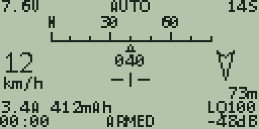

# apOSD

An OSD-style telemetry screen for **EdgeTX / OpenTX** radios and the **RadioMaster AX12**, for **ArduPilot** vehicles
over **CRSF / ELRS**. It shows on the radio's own screen the same kind of information a goggle OSD shows: battery, GPS
with an MGRS grid reference, speed, heading tape, home arrow and distance, flight mode, arm state, link quality and a
flight timer. The AX12 version also has a second page with an offline map under the vehicle.

Inspired by the [iNav OpenTX Telemetry Widget](https://github.com/iNavFlight/OpenTX-Telemetry-Widget). This is original
code for ArduPilot, not a copy of that project.

| Colour EdgeTX radios | Monochrome EdgeTX radios | RadioMaster AX12 |
|---|---|---|
|  |  |  |

*Renders from the included test simulator, not photos of a radio. Fonts are approximate.*

## Pick your version

| Your radio | Folder |
|---|---|
| Colour EdgeTX: RadioMaster TX16S, Jumper T16, Horus X10/X12, TX15, NV14 | [`edgetx/color-radios`](edgetx/color-radios) |
| Monochrome EdgeTX: RadioMaster GX12, Zorro, Boxer, TX12, Taranis X7 / X9D | [`edgetx/monochrome-radios`](edgetx/monochrome-radios) |
| RadioMaster AX12 (Android, RadioMasterOS) | [`ax12`](ax12) |

Each folder has its own README with install steps.

## Status

* **EdgeTX monochrome:** tested on a RadioMaster GX12 running EdgeTX 2.11, with live telemetry.
* **EdgeTX colour:** only run in the simulator so far.
* **AX12:** the app does not pass telemetry to Lua, so this version reads the app's own telemetry log (battery, heading,
  attitude, a rounded position). It was verified on a real AX12 against a recorded log; following a live vehicle is not yet verified.
  See [`ax12/README.md`](ax12/README.md) for what that means.
* All versions are checked in the simulator under Lua 5.2, 5.3 and 5.4 on a mock radio that, like EdgeTX and the AX12, has no
  string methods. The MGRS conversion was compared with a reference library on about 4,000 points worldwide with no mistakes.
* Not covered: FrSky S.Port / passthrough telemetry (CRSF / ELRS only).

## Licence

[MIT](LICENSE). Use at your own risk: hobby software for model vehicles, no warranty.
