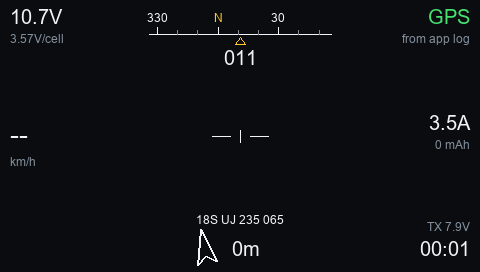

# apOSD for the RadioMaster AX12

An OSD-style telemetry screen for the **RadioMaster AX12** (Android radio running RadioMasterOS), for **ArduPilot**
vehicles over **CRSF / ELRS**: battery, GPS with an MGRS grid reference, heading tape, home arrow and distance,
attitude, and a timer. Unofficial: not made by or affiliated with RadioMaster.



*Render from the included simulator, not a photo of the radio. Fonts are approximate.*

## The important limit: the AX12 app does not give Lua any telemetry

On a normal EdgeTX radio a script reads telemetry with `getValue("RxBt")` and similar. On the AX12 (app version 26.06.11)
that does not work, even though the app shows live telemetry on its own Telemetry page:

* every named sensor (`RxBt`, `GPS`, `Sats`, ...) reads 0, and the 20 generic slots `telem1`..`telem20` read 0;
* `crossfireTelemetryPop()` exists but no frames ever arrive;
* the Lua API has no AX12-specific telemetry function.

What the app *does* do is write a log of telemetry about once a second to `AX12LUA/<YYYY_MM_DD>.txt`:

```
22:05:24.532 voltage:11.4v current:0 lat:38.9 lng:-77.0 pitch:-0.0064 roll:0.00567 yaw:-0.0643
```

So this version **reads that log** (`source = "log"` in `cfg.lua`). It means:

| Shown | Source |
|---|---|
| Battery volts, volts per cell (cell count guessed), current, used mAh (integrated) | log |
| Heading (from yaw), attitude (pitch / roll) | log |
| Position as MGRS, home arrow and distance | log, but **rounded** (about 11 m in latitude and about 90 m in longitude), so MGRS is shown to 100 m and home distance is approximate |
| Satellite count, speed, flight mode, armed state, link quality | **not available** (shown as `GPS` / `NO FIX`, `--`, nothing) |

If a future app version passes telemetry to Lua, set `source = "link"` and `mgrsDigits = 5`: the same code then reads the
usual sensors (`RxBt`, `GPS`, `Sats`, `GSpd`, `Yaw`, `Ptch`, `Roll`, `FM`, `RQly`, `1RSS`) and shows everything.

## Status

* Verified on a real AX12: the Lua environment (480 x 272 colour canvas, EdgeTX-style API, no string methods), the dark
  screen, and a replay of a real recorded log, which showed the correct battery, heading and position.
* Verified in the simulator: fresh, stale, missing and no-fix logs; the sensor mode; Lua 5.2, 5.3 and 5.4 on a mock radio
  without string methods; and the log reader against a real 1,700-line log (`tools/probe/test_reallog.py`).
* **Not yet verified:** following a live vehicle in real time.

## Install

You need `adb` (Google's Android platform-tools), a USB cable, and **USB debugging** on in the radio's Android settings.

```
adb devices
adb shell mkdir -p /sdcard/AX12LUA/SCRIPTS/TOOLS/apOSD
adb push SD/SCRIPTS/TOOLS/apOSD.lua /sdcard/AX12LUA/SCRIPTS/TOOLS/apOSD.lua
adb push SD/SCRIPTS/TOOLS/apOSD/cfg.lua /sdcard/AX12LUA/SCRIPTS/TOOLS/apOSD/cfg.lua
adb push SD/SCRIPTS/TOOLS/apOSD/data.lua /sdcard/AX12LUA/SCRIPTS/TOOLS/apOSD/data.lua
adb push SD/SCRIPTS/TOOLS/apOSD/color.lua /sdcard/AX12LUA/SCRIPTS/TOOLS/apOSD/color.lua
adb shell touch /sdcard/AX12LUA/SCRIPTS/TOOLS/apOSD.lua /sdcard/AX12LUA/SCRIPTS/TOOLS/apOSD/cfg.lua /sdcard/AX12LUA/SCRIPTS/TOOLS/apOSD/data.lua /sdcard/AX12LUA/SCRIPTS/TOOLS/apOSD/color.lua
```

Then **fully close and reopen the RadioMaster app**, open its **Lua** tab and tap **apOSD**. The **Exit** button closes it.

**Always run the `touch` line after copying files.** The app compiles each script to a `.luac` copy when it starts and
keeps that copy if it looks newer than the source. `adb push` keeps the file's old date, so a pushed file can be ignored.

The folder must look like this:

```
AX12LUA/SCRIPTS/TOOLS
├── apOSD.lua            the launcher: the entry shown in the Lua tab
└── apOSD                a folder with the same name
    ├── cfg.lua          your settings
    ├── data.lua
    ├── color.lua
    └── b.png            optional background picture
```

With no vehicle linked there is no log for today, so you see a flashing **NO TELEMETRY** banner. That is correct.

## Settings (`apOSD/cfg.lua`)

| Setting | Default | Meaning |
|---|---|---|
| `source` | `"log"` | `"log"`: read the app's log file; `"link"`: normal sensors |
| `logFile` | `""` | a fixed file such as `"/2026_10_15.txt"` to replay; empty = today's file |
| `maxAge` | `8` | seconds without a new log line before it counts as no telemetry (real gaps reach 7 s) |
| `theme` | `"dark"` | `"dark"` paints its own background (and the picture); `"light"` is dark text on the radio's pale canvas |
| `imperial` | `false` | mph and ft instead of km/h and m |
| `cells` | `0` | cell count; 0 guesses from the first voltage reading |
| `cellWarn` / `cellCrit` | `3.50` / `3.30` | volts per cell for yellow / red |
| `mgrs` / `mgrsDigits` | `true` / `3` | MGRS position; digits per axis (3 = 100 m, 4 = 10 m, 5 = 1 m) |
| `showAlt`, `horizon`, `beeps`, `minSats`, `armSwitch`, `background` | | as in the EdgeTX versions |

## Optional background picture

No picture is included. To add your own (only use pictures you have the right to use):

```
pip install pillow
python tools/make_bg.py --src my_picture.jpg --dim 0.3
```

It writes `SD/SCRIPTS/TOOLS/apOSD/b.png`; copy it to the radio next to the other files and restart the app.
The file must keep the short name `b.png`: this radio failed to open the longer `bg_480x272.png`. Without a picture
the screen is plain dark. `lcd.drawBitmap(bitmap, x, y, 100)` needs its fourth argument (scale, percent) on this radio;
without it nothing is drawn.

## Tools for finding out what a radio gives scripts (`tools/probe/`)

Small harmless Tools scripts. Put one in `TOOLS` like apOSD, restart the app, run it from the Lua tab, then read the
report it saves with `adb pull /sdcard/AX12LUA/<name>.txt`. They never record the GPS position.

| Script | Report | What it shows |
|---|---|---|
| `apProbe.lua` | `apProbe.txt` | screen size, which Lua functions exist, the telemetry names it can see |
| `apProbe4.lua` | `apProbe4.txt` | whether raw CRSF frames reach Lua (`crossfireTelemetryPop`) |
| `apProbe5.lua` | `apProbe5.txt` | every function and table the Lua exposes |
| `apColorTest.lua` | (screen) | which drawing calls paint: fills, `lcd.clear(colour)`, pictures, outlines, text |

## Testing without a radio

`tools/sim.py` is a mock radio that runs the real Lua files and renders the screen to a PNG. It behaves like the AX12:
no string methods, 480 x 272. It can fake the app's log (`--log`, `--logage N`, `--nolog`, `--nofix`). Needs
`pip install lupa pillow` (written for Windows fonts).

```
python tools/sim.py --screen 480x272 --scenario drive --log --out shot.png
python tools/sim.py --screen 480x272 --scenario lowbat --set source=link --out shot.png
python tools/probe/test_probe.py
```

## Licence

[MIT](../LICENSE). Use at your own risk: hobby software for model vehicles, no warranty.
