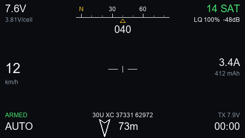
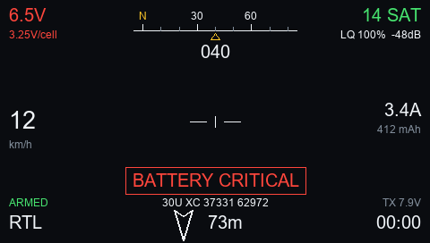
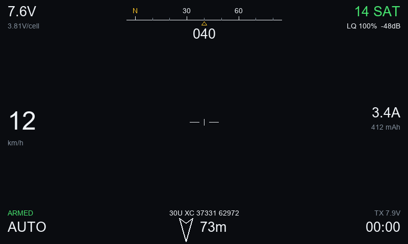

# apOSD, colour radio version (ArduPilot OSD mirror for EdgeTX / OpenTX)

For colour-screen radios: **RadioMaster TX16S, Jumper T16, Horus X10/X12, TX15, NV14** and similar.
For 128x64 / 212x64 monochrome radios (Taranis X7/X9D, Zorro, Boxer, TX12) use the other folder,
[`monochrome-radios`](../monochrome-radios).

A telemetry Lua script in the style of the [iNav OpenTX Telemetry Widget](https://github.com/iNavFlight/OpenTX-Telemetry-Widget),
but built for **ArduPilot** over **CRSF / ELRS**. It draws an OSD-style screen on the radio, the same
information your goggle OSD shows: battery, satellites, speed, heading tape, home arrow and distance,
flight mode, arm state, link quality and a flight timer, with an optional dimmed background picture.

| 480x272 (TX16S, T16) | Low battery | 800x480 (TX16S Mk3) |
|---|---|---|
|  |  |  |

These are renders from the test simulator in `tools/`, not photos of a radio. Fonts are approximate.
It cannot draw over live video: Lua on these radios has no access to a video feed. It mirrors the
OSD on the radio's own screen.

## Quick start

1. Copy everything **inside** this folder's `SD` folder (that is the `SCRIPTS` folder) onto the root of the
   radio's SD card. Say yes to merging. When you are done, `SCRIPTS/TELEMETRY` must contain the file
   `apOSD.lua` **and** a folder called `apOSD` (with `cfg.lua`, `data.lua` and `color.lua` inside it, plus
   the `bg_*.png` pictures if you made some). *Not* at the root of the card, and *not* in `SCRIPTS/TOOLS`.
2. Eject the card or drive properly, and restart the radio.
3. In the model settings, set a telemetry screen to type **Script** and choose `apOSD`
   (the page name varies with the EdgeTX version).

Telemetry scripts never show up in the Tools menu: that menu only lists scripts from `SCRIPTS/TOOLS`.

## What is in this folder

| Path | What it is |
|---|---|
| `SD/` | **The part that goes on the radio's SD card** |
| `SD/SCRIPTS/TELEMETRY/apOSD.lua` | Launcher |
| `SD/SCRIPTS/TELEMETRY/apOSD/cfg.lua` | Your settings (edit this) |
| `SD/SCRIPTS/TELEMETRY/apOSD/data.lua` | Reads the sensors, works out home distance and bearing |
| `SD/SCRIPTS/TELEMETRY/apOSD/color.lua` | The colour screen layout |
| `tools/make_bg.py` | Makes the optional background PNGs from a picture of your choice |
| `tools/sim.py` | Mock radio for testing without hardware |
| `preview/` | Simulator renders used above |

## Background picture (optional)

The colour screen can draw a dimmed picture behind the OSD. **No picture is included in this repository**, so by
default the screen is plain dark, which is fully usable. To add your own:

```
python tools/make_bg.py --src my_picture.jpg --dim 0.3
```

It fits your picture to each screen size (never cropped), darkens it so the white text stays readable, and
writes one file per size into `SD/SCRIPTS/TELEMETRY/apOSD/`: `bg_480x272.png` (TX16S, T16), `bg_480x320.png`
(TX15), `bg_800x480.png` (TX16S Mk3) and `bg_320x480.png` (NV14). Copy them to the radio with the rest of the files.
Only use pictures you have the right to use. Needs `pip install pillow`.

* Turn the picture off with `background = false` in `cfg.lua`.
* On a screen size with no matching file, or if the file can't be loaded, the screen stays plain dark.

## Where the files go on the radio

Everything the radio needs is inside this folder's `SD` folder. After copying, the SD card must look
**exactly** like this:

```
SD card (root)
└── SCRIPTS
    └── TELEMETRY
        ├── apOSD.lua            the launcher: the file you pick on the radio
        └── apOSD                a folder, named like the launcher without ".lua"
            ├── cfg.lua          your settings
            ├── data.lua
            ├── color.lua
            └── bg_<W>x<H>.png   optional background pictures (see above)
```

* Open the `SD` folder, select **everything inside it** (the `SCRIPTS` folder) and drag it onto the root of
  the SD card. Say yes if it asks to merge folders.
* Do **not** copy the `SD` folder itself, and don't copy `README.md`, `tools` or `preview`: those
  are for the PC.
* `apOSD.lua` goes in `SCRIPTS/TELEMETRY/`, not in `SCRIPTS/` and not inside the `apOSD` folder.
  Everything else goes inside the `apOSD` folder, not next to the launcher.
* Keep the names exactly as they are. The radio only allows 6 characters for a telemetry script name.
* Don't mix in files from the monochrome version.

## If the screen shows an error

In EdgeTX the message **"Syntax error"** is not only for typos. The radio also shows it when a script
**crashes while it is running**, or when its own cached copy of a script is bad. (Running out of memory is a
different message: "Script panic".)

This version catches those problems and shows the real reason on the screen instead. **ENTER retries.**

| What it says | What to do |
|---|---|
| `file missing` or `could not load` | Check the folder layout above, in particular the `apOSD` folder next to `apOSD.lua`. |
| Text with `.lua:` and a line number, or any other message | The script crashed. Please open an issue with the exact text. |
| The radio itself says **Syntax error** or **Script panic**, before this screen appears | Delete the `.luac` files (see below), reboot the radio and try again. If it comes back, open an issue with the radio model and EdgeTX version. |

**About `.luac` files.** On most radios (it depends on the firmware build) the first time a `.lua` script is
loaded, the radio writes a compiled copy next to it with the extension `.luac` and uses that copy from then
on. This is normal and the radio creates them itself. They are safe to delete at any time; the radio just makes
new ones. If the script works once and then fails, delete every `.luac` file under `SCRIPTS/TELEMETRY/` and
reboot.

## Install

1. Copy the **contents of `SD/`** onto the radio's SD card, merging with the existing `SCRIPTS` folder.
   You should end up with `SCRIPTS/TELEMETRY/apOSD.lua` and the folder `SCRIPTS/TELEMETRY/apOSD/`.
2. With the vehicle powered and linked, open **Model Settings → Telemetry** and run **Discover new sensors**.
3. Assign the script to a screen on the **Telemetry / Screens** page: set a screen's type to **Script** and pick
   `apOSD`. Menu names vary a little between EdgeTX versions.
4. Open that telemetry screen from the main view (on EdgeTX colour radios how you reach it depends on the version).

Long-press **ENTER** on the screen to reset home to the vehicle's current position.

## ArduPilot setup

* One serial port set to CRSF (`SERIALx_PROTOCOL = 23`), connected to the receiver.
* **Recommended:** set `RC_OPTIONS` **bit 12** (add **4096** to the current value). ArduPilot then puts a `*`
  after the flight mode while disarmed, which is the only way telemetry can tell the script whether the
  vehicle is armed. Without it the script still works, but shows no ARMED / DISARMED label, records home at
  the first GPS fix instead of at arming, and starts the timer at the first fix.
  If you would rather not use that option, set `armSwitch` in `cfg.lua` to the radio switch you arm with.

## Sensors it uses

The names EdgeTX gives CRSF sensors: `RxBt` (battery volts), `Curr`, `Capa`, `Bat%`, `GPS`, `Sats`, `GSpd`, `Alt`,
`Yaw`, `Ptch`, `Roll`, `FM`, `RQly`, `1RSS`. If one is missing the script keeps working and shows 0 for it.
Heading comes from `Yaw` (compass). `Hdg` (GPS course) is only a fallback.

Speed is expected in km/h and altitude in m, which is how EdgeTX reports CRSF.
Home distance and bearing are not sent by ArduPilot over CRSF, so the script computes them from `GPS`.

## Settings (`SD/SCRIPTS/TELEMETRY/apOSD/cfg.lua`)

| Setting | Default | Meaning |
|---|---|---|
| `imperial` | `false` | mph and ft instead of km/h and m |
| `cells` | `0` | cell count; 0 guesses from the first voltage (set it by hand if you power up with a very flat pack) |
| `cellWarn` / `cellCrit` | `3.50` / `3.30` | volts per cell for yellow / red (red flashes and beeps) |
| `minSats` | `6` | satellites needed before home is recorded |
| `showAlt` | `false` | show altitude above home |
| `horizon` | `false` | artificial horizon from pitch and roll |
| `armSwitch` | `""` | radio switch that tracks arming, e.g. `"sf"` or `"ls1"`; armed when its value is above 0 |
| `beeps` | `true` | tones on arm, disarm and critical battery |
| `mgrs` | `true` | show the position as an MGRS grid reference. On the small screens it takes the place of the current / mAh text; press ENTER to swap them |
| `mgrsDigits` | `5` | digits per axis: 5 = 1 m, 4 = 10 m (8-digit grid), 3 = 100 m |
| `background` | `true` | dimmed picture behind the OSD (only if `bg_*.png` files are present) |

## Position as MGRS

The OSD shows your GPS position as an MGRS grid reference, for example `18S UJ 23478 06483`: grid zone and
latitude band, the 100 km square, then easting and northing. It is calculated on the radio from the GPS
latitude and longitude, with the zone exceptions for Norway and Svalbard. Outside 80°S to 84°N, where MGRS uses a
different grid, and while there is no GPS fix, it shows `MGRS --`.

* On the monochrome screens it replaces the current / mAh text. **Press ENTER** to swap between them.
* On the colour screens it sits at the bottom centre.
* Set `mgrs = false` in `cfg.lua` to switch it off.
* Accuracy: checked against a reference MGRS library on about 4,000 points worldwide with no mistakes (identical or a
  1 m rounding difference). If your radio's Lua uses single-precision numbers, expect roughly 1 m typical and up
  to about 2.5 m worst case, which is similar to the GPS's own error. At 5 digits the last digit may flicker;
  set `mgrsDigits = 4` for a steadier 10 m reference.

## Not covered

* FrSky S.Port / passthrough telemetry. It only reads CRSF / ELRS sensors.
* Radios older than OpenTX 2.3 / EdgeTX 2.x.
* Not yet run on a real radio, only on the simulator. Font sizes and menu names may need small adjustments.

## Testing without a radio

`tools/sim.py` is a mock EdgeTX that runs the real Lua files under Lua 5.2, 5.3 or 5.4 and renders the
screen to a PNG for ten scenarios (`drive`, `disarmed`, `nostar`, `lowbat`, `warnbat`, `nolink`, `nogps`,
`tilt`, `north`, `fast`) on the colour screen sizes `480x272`, `480x320`, `800x480` and `320x480`.

```
pip install lupa pillow
python tools/sim.py --screen 480x272 --scenario lowbat --out shot.png
python tools/sim.py --screen 800x480 --scenario tilt --set horizon=true --lua 54
python tools/sim.py --screen 480x272 --scenario drive --nobg      (pretend the background file is missing)
```

It was written for Windows (it loads Arial from `C:\Windows\Fonts`).
